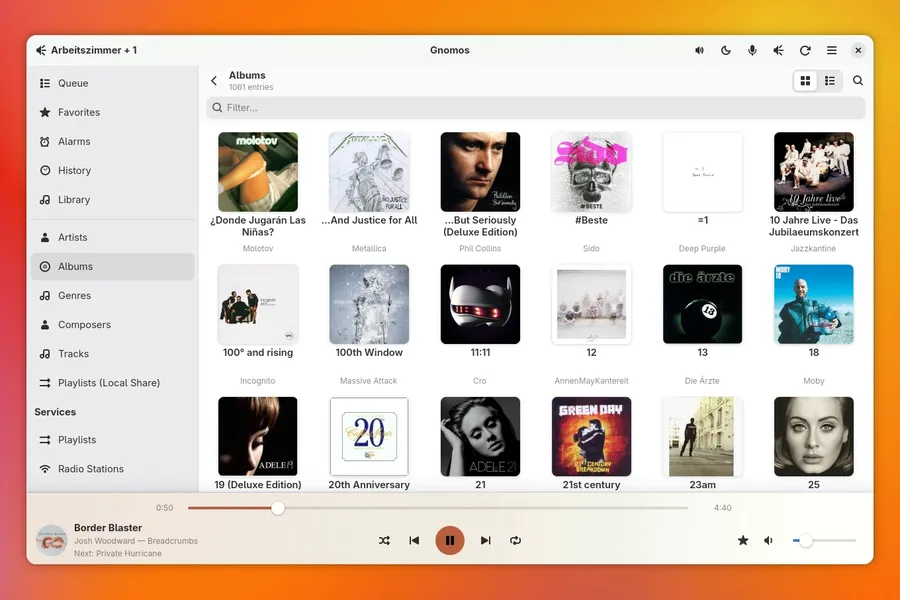
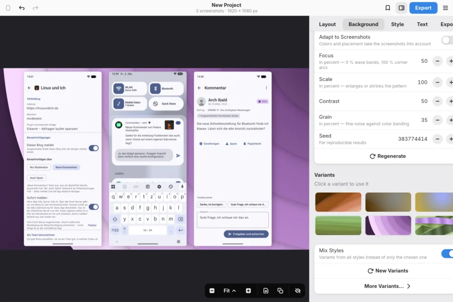
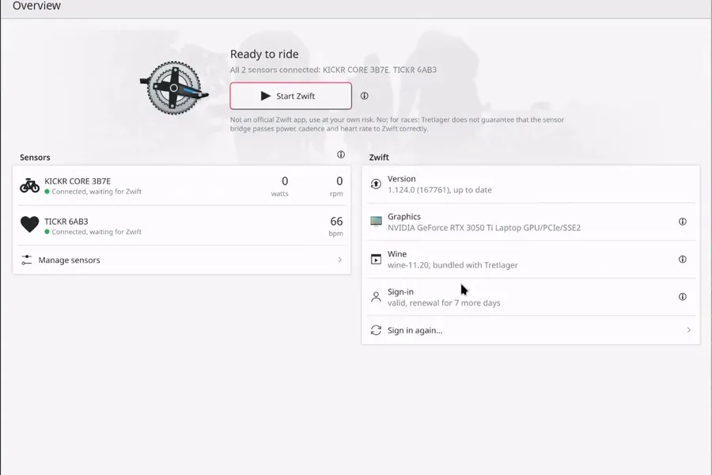
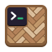
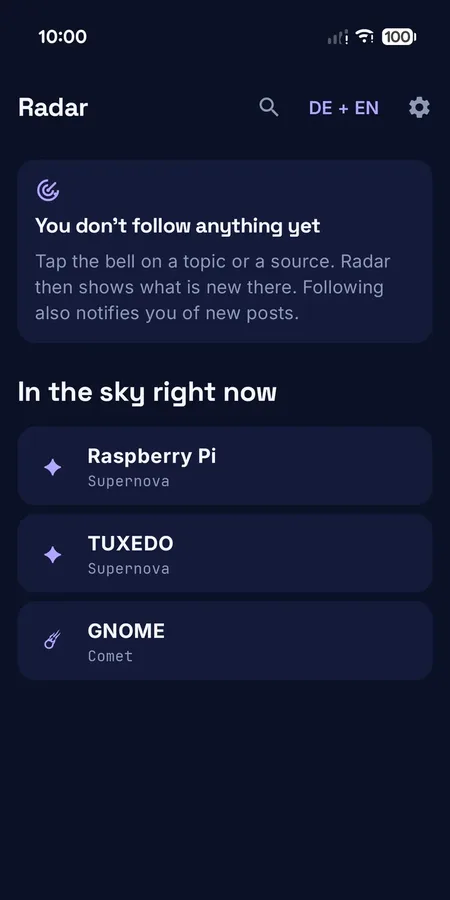
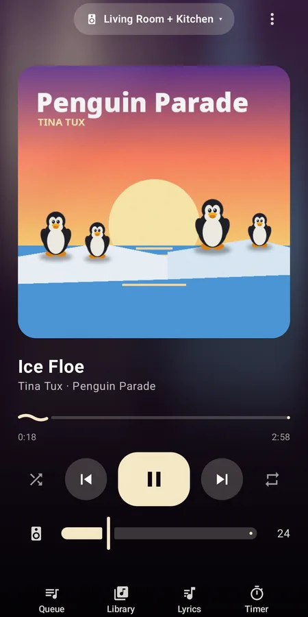
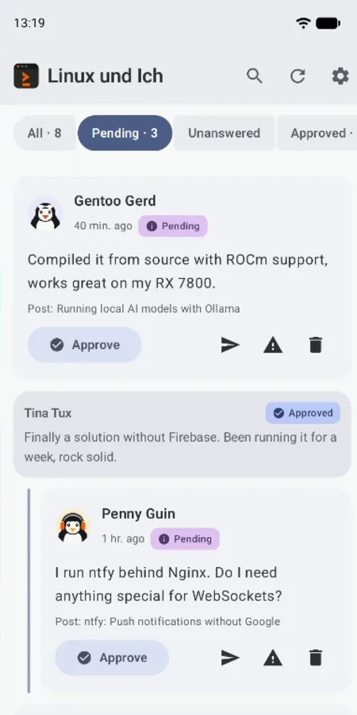

<picture>
  <source media="(prefers-color-scheme: dark)" srcset="../assets/header-dark.svg">
  
</picture>

Open source apps for the Linux desktop and Android, written and maintained by Christoph Langner ([@linuxundich](https://github.com/linuxundich)). Small tools that do one job well, built with the platform's own toolkit.

[Website](https://freiversum.de/en/) &nbsp;·&nbsp; [Blog](https://linuxundich.de/en/) &nbsp;·&nbsp; [Mastodon](https://social.anoxinon.de/@linuxundich) &nbsp;·&nbsp; [All repositories](https://github.com/orgs/freiversum/repositories)

<table>
  <tr>
    <td width="25%" valign="top"><b>Native</b> GTK 4 and libadwaita on GNOME, Kirigami on Plasma, Jetpack Compose on Android</td>
    <td width="25%" valign="top"><b>Local first</b> Works on your network and your machine, no account where none is needed</td>
    <td width="25%" valign="top"><b>No tracking</b> No analytics and no ads in the apps</td>
    <td width="25%" valign="top"><b>Free software</b> Open licenses, mostly GPL-3.0, English and German, developed in the open</td>
  </tr>
</table>

## Linux desktop

<table>
  <tr>
    <td width="33%" align="center" valign="top"> Gnomos</td>
    <td width="33%" align="center" valign="top"> ScreenForge</td>
    <td width="33%" align="center" valign="top"> Tretlager</td>
  </tr>
</table>

| | Project | What it does | Get it |
|---|---|---|---|
|  | [**Gnomos**](https://github.com/freiversum/gnomos) C++ · GTK 4 | Sonos controller, local network only | [Flatpak, .deb](https://github.com/freiversum/gnomos/releases/latest) |
|  | [**Parkett**](https://github.com/freiversum/parkett) Rust · GTK 4 | Terminal with splits, the Tilix way | [Source](https://github.com/freiversum/parkett/releases/latest) |
|  | [**Dandelion**](https://github.com/freiversum/dandelion) Python · GTK 4 | Post to Mastodon, Bluesky and more at once | [Flatpak](https://github.com/freiversum/dandelion/releases/latest) |
|  | [**ScreenForge**](https://github.com/freiversum/ScreenForge) Rust · GTK 4 | Compose smartphone screenshots | [Build from source](https://github.com/freiversum/ScreenForge#readme) |
|  | [**Tretlager**](https://github.com/freiversum/tretlager) Python · Kirigami | Zwift on Linux, with a Bluetooth sensor bridge | [Flatpak, .deb](https://github.com/freiversum/tretlager/releases/latest) |
|  | [**Pulsgeber**](https://github.com/freiversum/pulsgeber) GNOME Shell | TUXEDO Control Center profiles in Quick Settings | [Extension ZIP](https://github.com/freiversum/pulsgeber/releases/latest) |

## Android

<table>
  <tr>
    <td width="33%" align="center" valign="top"> PlanetFOSS</td>
    <td width="33%" align="center" valign="top"> Hausmusik</td>
    <td width="33%" align="center" valign="top"> Commentator</td>
  </tr>
</table>

| | Project | What it does | Get it |
|---|---|---|---|
|  | [**PlanetFOSS**](https://github.com/freiversum/planetfoss-android) Kotlin · Compose | Linux and open source news reader | [APK](https://github.com/freiversum/planetfoss-android/releases/latest) · [Google Play (test)](https://play.google.com/apps/testing/net.planetfoss.app) |
|  | [**Hausmusik**](https://github.com/freiversum/hausmusik) Kotlin · Compose | Local Sonos controller, also for S1 players | [APK](https://github.com/freiversum/hausmusik/releases/latest) |
|  | [**Commentator**](https://github.com/freiversum/commentator) Kotlin · WordPress plugin | Moderate WordPress comments from your phone | [APK](https://github.com/freiversum/commentator/releases/latest) |

<b>Libraries and building blocks</b>

 

[**prospekt**](https://github.com/freiversum/prospekt) – procedural backgrounds that look designed. The Rust/Cairo generator behind ScreenForge, usable on its own.

## Contributing

> [!TIP]
> Bug reports, ideas and pull requests go straight to the project's repository. Translations are welcome; most apps ship in English and German.

Before larger changes, please open an issue first so we can talk about the approach. Security issues: use *Report a vulnerability* in the repository instead of a public issue.

 

   
  A star in the <a href="https://freiversum.de/en/">freiversum</a>

